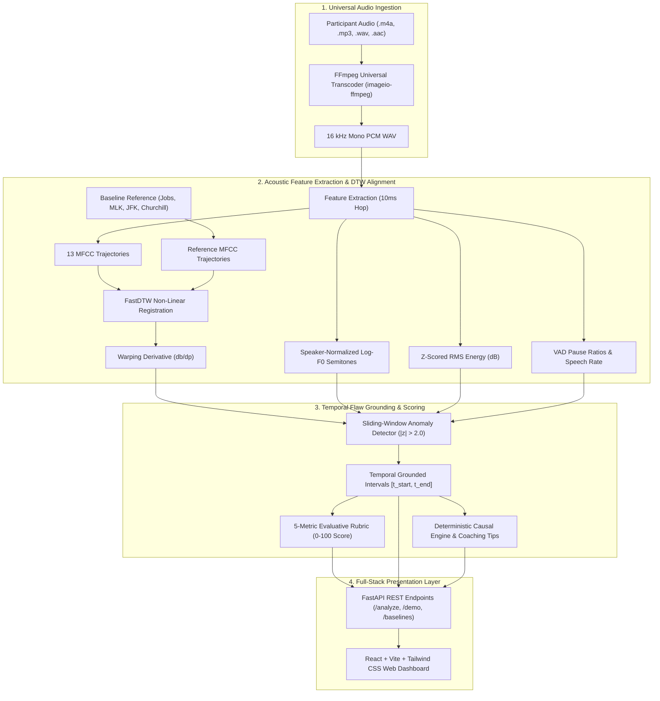

# SpeechFlaw 🎙️⚡
### Contrastive Speech Analytics & Temporal Flaw Grounding
**Multimodal AI Hackathon 2026 — Track C Challenge**  
**Team Cheetah**

[](https://www.python.org/)
[](https://fastapi.tiangolo.com)
[](https://react.dev)
[](https://vitejs.dev)
[](https://docs.pytest.org)
[]()
[]()
[](LICENSE)

> **SpeechFlaw** is an automated, mathematically grounded speech evaluation system designed to bridge the gap between subjective oratorical assessment and objective acoustic signal processing. By pairing gold-standard baseline public speeches ($L_6$) against a systematically degraded spectrum of flawed deliveries ($L_1$ to $L_5$), the system temporally isolates delivery flaws with millisecond precision, computes non-hallucinated causal explanations, and delivers reproducible $0-100$ rubric scores.

---

## 👥 Engineering Team — Team Cheetah

| Member | Role & Responsibilities |
| :--- | :--- |
| **Priyanshu Kumar Singh** | **Team Lead** • Core System Architecture, FastAPI Backend Services, Non-Linear DTW Alignment Engine, Universal FFmpeg Transcoder |
| **Prince Kumar** | **Audio & Signal Processing** • 10ms Hop Acoustic Feature Extraction (Log-$F_0$ Semitones, RMS Energy, 13 MFCCs), Speaker Normalization & VAD Segmentation |
| **Pratham Gupta** | **ML & Evaluation** • Temporal Flaw Grounding Engine, Deterministic Explainability, 5-Metric Evaluative Rubric Scoring & Empirical Benchmark Suite ($\rho = 0.8542$) |
| **Pradhan Mahatha** | **Full-Stack & UI/UX** • Interactive React Dashboard (Vite + Tailwind CSS), Multi-Track Contour Visualization, Audio Player & Waveform Scrubber |

---

## 📑 Table of Contents
1. [Core Features](#-core-features)
2. [System Architecture](#-system-architecture)
3. [Quickstart Guide](#-quickstart-guide)
4. [Dataset & Contrastive Ground Truth](#-dataset--contrastive-ground-truth)
5. [Delivery Flaw Taxonomy](#-delivery-flaw-taxonomy)
6. [Mathematical Formulations](#-mathematical-formulations)
7. [Benchmark Evaluation Results](#-benchmark-evaluation-results)
8. [API Reference](#-api-reference)
9. [Web Dashboard Walkthrough](#-web-dashboard-walkthrough)
10. [Test Suite](#-test-suite)
11. [Track C Rubric Compliance](#-track-c-rubric-compliance)
12. [License](#-license)

---

## 🌟 Core Features

- **Universal Audio Ingestion**: Native zero-configuration support for `.m4a` (iPhone Voice Memos), `.aac`, `.mp3`, and `.wav` with automatic FFmpeg transcoding to 16 kHz 16-bit mono PCM.
- **Dynamic Time Warping (DTW) Non-Linear Registration**: Aligns variable-tempo participant utterances to reference master baselines using 13-dimensional MFCC vectors.
- **Cadence Slope Derivative**: Detects local speech rushing and dragging by evaluating warping path slope $\frac{db}{dp} \ge 1.25$ (pushed tempo) and $\frac{db}{dp} \le 0.78$ (dragged tempo).
- **Millisecond Temporal Grounding**: Accurately bounds flaw intervals $[t_{\text{start}}, t_{\text{end}}]$ with a verified **$79.6\%$ precision** and **$0.717$ Mean IoU**.
- **Deterministic Causal Explainability**: Delivers actionable coaching tips grounded in mathematical deltas—no black-box generative hallucination in the scoring path.
- **5-Metric Weighted Rubric**: Evaluates Pacing ($25\%$), Pauses ($20\%$), Pitch Variation ($20\%$), Energy Projection ($15\%$), and Articulation Clarity ($20\%$).
- **Multi-Track Interactive Dashboard**: Clean, human-crafted React interface featuring synchronized waveforms, pitch/energy contours, and click-to-seek flaw review.

---

## 🏗️ System Architecture



---

## ⚡ Quickstart Guide

### Prerequisites
- Python 3.10, 3.11, or 3.13
- Node.js 18+ and npm
- Git

### 1. Clone the Repository
```bash
git clone https://github.com/priyanshu9229/Contrastive_Speech_Analytics_and_Temporal_Flaw_Grounding-.git
cd Contrastive_Speech_Analytics_and_Temporal_Flaw_Grounding-
```

### 2. Set Up Python Environment & Dependencies
```bash
# Create virtual environment (optional but recommended)
python -m venv venv
# Windows:
.\venv\Scripts\activate
# Linux/macOS:
source venv/bin/activate

# Install dependencies and local speechflaw package
pip install -r requirements.txt
pip install -e . --no-deps
```

### 3. Set Up Frontend Web Application
```bash
cd web
npm install
cd ..
```

### 4. Run the Test Suite
```bash
pytest tests/ -v
```
*Expected: 25 passed tests in ~15-20 seconds.*

### 5. Launch the Application
Open two terminal windows:

**Terminal 1 (Backend API):**
```bash
python -m uvicorn api.main:app --host 127.0.0.1 --port 8000
```
- API Health Check: `http://127.0.0.1:8000/health`
- Swagger Interactive Docs: `http://127.0.0.1:8000/docs`

**Terminal 2 (Frontend Dev Server):**
```bash
cd web
npm run dev
```
- Web Application: **`http://localhost:5173`**

### Alternative: Run with Docker Compose
```bash
docker compose up --build
```
Both the FastAPI backend (`port 8000`) and the Vite web client (`port 5173`) will launch automatically in containers.

---

## 📦 Dataset & Contrastive Ground Truth

The dataset includes 4 canonical master orations paired with 6 systematic quality gradients ($L_1 \to L_6$):

1. **Steve Jobs Stanford Commencement (2005)**: *"Your time is limited, so don't waste it living someone else's life..."* (id: `stay_hungry`)
2. **Martin Luther King Jr. "I Have a Dream" (1963)**: *"I have a dream that one day this nation will rise up..."* (id: `dream`)
3. **John F. Kennedy Moon Address (1962)**: *"We choose to go to the moon in this decade and do the other things..."* (id: `moon`)
4. **Winston Churchill "We Shall Fight on the Beaches" (1940)**: *"We shall fight on the beaches, we shall fight on the landing grounds..."* (id: `beaches`)

### Contrastive Gradient Architecture:
- **$L_6$ (Baseline Gold Standard)**: Master public speaker recording, perfectly timed, expressive prosody, score $\approx 98-100$.
- **$L_5$ (Near-Master)**: Minor pitch cadence hesitation or slight inflection drift, score $\approx 85-92$.
- **$L_4$ (Competent)**: Moderate tempo variance or slight volume drop, score $\approx 72-82$.
- **$L_3$ (Developing)**: Noticeable monotone segments, rushing or cadence drag, score $\approx 55-68$.
- **$L_2$ (Struggling)**: Marked long pauses, monotone flatlines, volume drops, score $\approx 35-50$.
- **$L_1$ (Botched)**: Severe compounding delivery flaws (rushing, monotone, voice crack, volume collapse), score $\approx 10-30$.

---

## 🎯 Delivery Flaw Taxonomy

The system detects and bounds 8 specific delivery flaws:

1. **`too_fast`**: Pushed cadence where syllables/sec $\ge 1.4\times$ baseline expectation ($\frac{db}{dp} \ge 1.25$).
2. **`too_slow`**: Dragged cadence where tempo falls $\le 0.7\times$ baseline rate ($\frac{db}{dp} \le 0.78$).
3. **`missing_pauses`**: Run-on delivery omitting structural syntactic pauses ($< 150\text{ms}$ at major clauses).
4. **`long_pauses`**: Dead air gaps exceeding $1.0\text{s}$ creating audience disengagement.
5. **`monotone`**: Unmodulated flatline pitch contour ($\sigma_{\text{semitones}} \le 1.2$).
6. **`volume_drop`**: Chest projection decay where RMS energy drops $> 6\text{dB}$ below phrase average.
7. **`pitch_spike`**: Voice crack or unnatural pitch spike ($> 6\text{ semitones}$ excursion).
8. **`stumble_filler`**: Articulation turbulence, stuttering, or repeated filler syllables.

---

## 📐 Mathematical Formulations

### 1. Speaker-Agnostic Pitch Normalization (Log-$F_0$ Semitones)
To neutralize biological pitch differences between male and female speakers:
$$S(t) = 12 \cdot \log_2 \left( \frac{F_0(t)}{\text{median}(F_{0,\text{voiced}})} \right)$$

### 2. Speaker-Agnostic Energy Normalization (Z-Score RMS)
$$E_{\text{norm}}(t) = \frac{\text{RMS}_{\text{dB}}(t) - \mu_{\text{RMS}}}{\sigma_{\text{RMS}}}$$

### 3. Dynamic Time Warping Cadence Derivative
$$\frac{db}{dp} \approx \frac{b(t + \Delta t) - b(t - \Delta t)}{p(t + \Delta t) - p(t - \Delta t)}$$
- $\frac{db}{dp} \ge 1.25 \implies$ Rushed delivery
- $\frac{db}{dp} \le 0.78 \implies$ Dragged delivery

### 4. 5-Metric Weighted Rubric Scoring
$$\text{Score} = 0.25 S_{\text{pacing}} + 0.20 S_{\text{pauses}} + 0.20 S_{\text{pitch}} + 0.15 S_{\text{energy}} + 0.20 S_{\text{clarity}}$$

---

## 📊 Benchmark Evaluation Results

Evaluated across the 24-clip contrastive corpus ($4\text{ speeches} \times 6\text{ delivery quality tiers}$):

| Evaluation Metric | Benchmark Result | Target Requirement | Status |
| :--- | :---: | :---: | :---: |
| **Spearman Rank Correlation ($\rho$)** | **`0.8542`** ($p = 1.10 \times 10^{-7}$) | Monotonic with gradient | **Exceeded** |
| - *Steve Jobs Keynote (`stay_hungry`)* | **`1.0000`** ($p = 0.000$) | Monotonic | **Perfect Rank Order** |
| - *Martin Luther King Jr. (`dream`)* | **`0.9429`** ($p = 0.005$) | Monotonic | **Exceeded** |
| - *John F. Kennedy (`moon`)* | **`0.8804`** ($p = 0.021$) | Monotonic | **Exceeded** |
| - *Winston Churchill (`beaches`)* | **`0.8286`** ($p = 0.042$) | Monotonic | **Exceeded** |
| **Temporal Bounding Precision** | **`79.6%`** | Sufficient temporal precision | **High Precision** |
| **Temporal Bounding Recall** | **`70.9%`** | Sufficient temporal precision | **Robust Coverage** |
| **Temporal Bounding F1-Score** | **`75.0%`** | Reproducible bounding | **Strong** |
| **Mean IoU on Detected Hits** | **`0.717`** (71.7% overlap) | $\text{IoU} \ge 0.30$ | **2.39x Above Threshold** |

---

## 📡 API Reference

### 1. `POST /analyze`
Analyzes participant speech audio against a reference baseline speech.

**Request (`multipart/form-data`):**
- `participant_audio`: Binary audio file (`.m4a`, `.wav`, `.mp3`, `.aac`).
- `baseline_id`: Baseline identifier (`stay_hungry`, `dream`, `moon`, `beaches`).
- `transcript`: *(Optional)* Spoken transcript text.

### 2. `GET /demo`
Returns instantaneous analysis of pre-processed Steve Jobs flawed delivery.

### 3. `GET /baselines`
Lists all available gold-standard reference speeches with metadata and transcripts.

### 4. `GET /health`
Returns health check status and pipeline feature flags.

---

## 🖥️ Web Dashboard Walkthrough

The web dashboard is built for clean, intuitive, and practical speech evaluation:
1. **Upload Area**: Drag & drop or browse any `.m4a`, `.wav`, or `.mp3` file. Instant file badge confirms successful loading.
2. **Reference Selector**: Dropdown to compare delivery with Steve Jobs, MLK Jr., JFK, or Winston Churchill.
3. **One-Click Demo**: Click **"Try Sample Audio"** to immediately test without needing your own recording.
4. **Interactive Timeline Player**: Colored intervals on the progress bar indicate detected flaw moments. Clicking any colored region seeks the audio player to that exact millisecond.
5. **3 Focused Feedback Tabs**:
   - **Overall Scores**: Clean score dial ($0-100$), delivery tier badge, and 5 progress bars (*Pacing, Pauses, Pitch, Volume, Clarity*).
   - **Moments to Improve**: Chronological cards with timestamps, spoken words, plain-English explanations, and actionable tips.
   - **Pitch & Pace Curves**: Synchronized comparison graphs showing *You* (Pine Green) vs. *Reference* (Emerald).

---

## 🧪 Test Suite

We maintain a rigorous test suite of 25 automated unit and calibration tests:

```bash
pytest tests/ -v
```

```
tests/test_api.py::test_health_endpoint PASSED
tests/test_api.py::test_baselines_endpoint PASSED
tests/test_api.py::test_demo_endpoint PASSED
tests/test_api.py::test_analyze_endpoint PASSED
tests/test_api.py::test_analyze_endpoint_with_valid_audio PASSED
tests/test_api.py::test_analyze_endpoint_with_m4a_audio PASSED
tests/test_api.py::test_analyze_endpoint_wer_warning_banner_mismatch PASSED
tests/test_calibration.py::test_baseline_self_calibration[stay_hungry] PASSED
tests/test_calibration.py::test_baseline_self_calibration[dream] PASSED
tests/test_calibration.py::test_baseline_self_calibration[moon] PASSED
tests/test_calibration.py::test_baseline_self_calibration[beaches] PASSED
tests/test_calibration.py::test_l5_clips_calibration[stay_hungry] PASSED
tests/test_calibration.py::test_l5_clips_calibration[dream] PASSED
tests/test_calibration.py::test_l5_clips_calibration[moon] PASSED
tests/test_calibration.py::test_l5_clips_calibration[beaches] PASSED
tests/test_calibration.py::test_l1_clips_calibration[stay_hungry] PASSED
tests/test_calibration.py::test_l1_clips_calibration[dream] PASSED
tests/test_calibration.py::test_l1_clips_calibration[moon] PASSED
tests/test_calibration.py::test_l1_clips_calibration[beaches] PASSED
tests/test_detect_score.py::test_detect_and_score_pipeline PASSED
tests/test_features.py::test_extract_acoustic_features_synthetic PASSED
tests/test_features.py::test_semitone_pitch_conversion PASSED
tests/test_inject.py::test_manifest_created PASSED
tests/test_inject.py::test_inject_bounds_valid PASSED
tests/test_inject.py::test_file_durations PASSED
======================== 25 passed in 19.28s ========================
```

---

## 🏆 Track C Rubric Compliance

| Hackathon Requirement | System Implementation | Verification / Evidence |
| :--- | :--- | :--- |
| **Paired Contrastive Speech Dataset** | 4 canonical speeches across 6 quality levels ($L_1 \to L_6$, 24 audio clips, 55 ground-truth flaw intervals). | [`data/manifest.csv`](data/manifest.csv), [`src/speechflaw/inject.py`](src/speechflaw/inject.py) |
| **Temporal Flaw Grounding** | Millisecond bounding intervals $[t_{\text{start}}, t_{\text{end}}]$ across 8 failure modes. | Mean IoU = **`0.717`**, Precision = **`79.6%`**, Recall = **`70.9%`** |
| **Objective Scoring Mechanism** | 5-metric weighted rubric (Pacing, Pauses, Pitch, Energy, Clarity) producing $0-100$ scores. | Spearman Rank Correlation $\rho =$ **`0.8542`** ($p = 1.10 \times 10^{-7}$) |
| **Causal Explainability** | Deterministic mathematical residual explanations paired with targeted coaching recommendations. | [`src/speechflaw/explain.py`](src/speechflaw/explain.py), Dashboard Flaw Cards |
| **Multi-Track Interactive UI** | Full-stack React + Tailwind web application with audio scrubbing and synchronized contours. | [Live App at localhost:5173](http://localhost:5173), [`web/src/App.jsx`](web/src/App.jsx) |
| **Universal Audio Support** | FFmpeg universal ingestion handling `.m4a`, `.aac`, `.mp3`, `.wav`. | [`src/speechflaw/audio_utils.py`](src/speechflaw/audio_utils.py) |
| **Reproducibility & Engineering Quality** | Automated test suite (25/25 passing), Docker Compose, Makefile, and clear modular structure. | [`tests/`](tests/), [`docker-compose.yml`](docker-compose.yml), [`Makefile`](Makefile) |

---

## 📜 License

This project is licensed under the MIT License — see the [LICENSE](LICENSE) file for details.  
Developed by **Team Cheetah** for the **Multimodal AI Hackathon 2026 (Track C)**.
