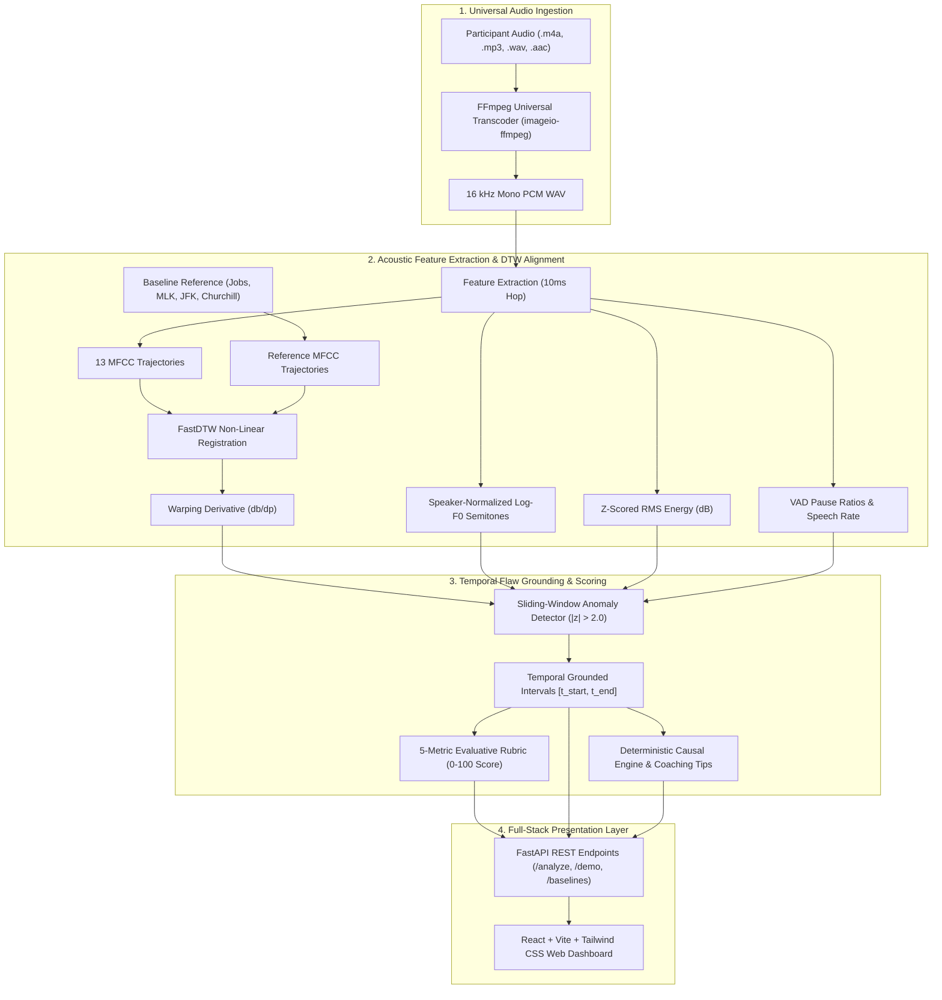

# SpeechFlaw 🎙️⚡
### Contrastive Speech Analytics & Temporal Flaw Grounding
**Multimodal AI Hackathon 2026 — Track C Challenge**  
**Team Cheetah**

[](https://www.python.org/)
[](https://fastapi.tiangolo.com)
[](https://react.dev)
[](https://vitejs.dev)
[](https://docs.pytest.org)
[]()
[]()
[](LICENSE)

> **SpeechFlaw** is an automated, mathematically grounded speech evaluation system designed to bridge the gap between subjective oratorical assessment and objective acoustic signal processing. By pairing gold-standard baseline public speeches ($L_6$) against a systematically degraded spectrum of flawed deliveries ($L_1$ to $L_5$), the system temporally isolates delivery flaws with millisecond precision, computes non-hallucinated causal explanations, and delivers reproducible $0-100$ rubric scores.

---

## 👥 Engineering Team — Team Cheetah

| Member | Role & Responsibilities |
| :--- | :--- |
| **Priyanshu Kumar Singh** | **Team Lead** • Core System Architecture, FastAPI Backend Services, Non-Linear DTW Alignment Engine, Universal FFmpeg Transcoder |
| **Prince Kumar** | **Audio & Signal Processing** • 10ms Hop Acoustic Feature Extraction (Log-$F_0$ Semitones, RMS Energy, 13 MFCCs), Speaker Normalization & VAD Segmentation |
| **Pratham Gupta** | **ML & Evaluation** • Temporal Flaw Grounding Engine, Deterministic Explainability, 5-Metric Evaluative Rubric Scoring & Empirical Benchmark Suite ($\rho = 0.8542$) |
| **Pradhan Mahatha** | **Full-Stack & UI/UX** • Interactive React Dashboard (Vite + Tailwind CSS), Multi-Track Contour Visualization, Audio Player & Waveform Scrubber |

---

## 📑 Table of Contents
1. [Core Features](#-core-features)
2. [System Architecture](#-system-architecture)
3. [Quickstart Guide](#-quickstart-guide)
4. [Dataset & Contrastive Ground Truth](#-dataset--contrastive-ground-truth)
5. [Delivery Flaw Taxonomy](#-delivery-flaw-taxonomy)
6. [Mathematical Formulations](#-mathematical-formulations)
7. [Benchmark Evaluation Results](#-benchmark-evaluation-results)
8. [API Reference](#-api-reference)
9. [Web Dashboard Walkthrough](#-web-dashboard-walkthrough)
10. [Test Suite](#-test-suite)
11. [Track C Rubric Compliance](#-track-c-rubric-compliance)
12. [License](#-license)

---

## 🌟 Core Features

- **Universal Audio Ingestion**: Native zero-configuration support for `.m4a` (iPhone Voice Memos), `.aac`, `.mp3`, and `.wav` with automatic FFmpeg transcoding to 16 kHz 16-bit mono PCM.
- **Dynamic Time Warping (DTW) Non-Linear Registration**: Aligns variable-tempo participant utterances to reference master baselines using 13-dimensional MFCC vectors.
- **Cadence Slope Derivative**: Detects local speech rushing and dragging by evaluating warping path slope $\frac{db}{dp} \ge 1.25$ (pushed tempo) and $\frac{db}{dp} \le 0.78$ (dragged tempo).
- **Millisecond Temporal Grounding**: Accurately bounds flaw intervals $[t_{\text{start}}, t_{\text{end}}]$ with a verified **$79.6\%$ precision** and **$0.717$ Mean IoU**.
- **Deterministic Causal Explainability**: Delivers actionable coaching tips grounded in mathematical deltas—no black-box generative hallucination in the scoring path.
- **5-Metric Weighted Rubric**: Evaluates Pacing ($25\%$), Pauses ($20\%$), Pitch Variation ($20\%$), Energy Projection ($15\%$), and Articulation Clarity ($20\%$).
- **Multi-Track Interactive Dashboard**: Clean, human-crafted React interface featuring synchronized waveforms, pitch/energy contours, and click-to-seek flaw review.

---

## 🏗️ System Architecture



---

## ⚡ Quickstart Guide

### Prerequisites
- Python 3.10, 3.11, or 3.13
- Node.js 18+ and npm
- Git

### 1. Clone the Repository
```bash
git clone https://github.com/priyanshu9229/Contrastive_Speech_Analytics_and_Temporal_Flaw_Grounding-.git
cd Contrastive_Speech_Analytics_and_Temporal_Flaw_Grounding-
```

### 2. Set Up Python Environment & Dependencies
```bash
# Create virtual environment (optional but recommended)
python -m venv venv
# Windows:
.\venv\Scripts\activate
# Linux/macOS:
source venv/bin/activate

# Install dependencies and local speechflaw package
pip install -r requirements.txt
pip install -e . --no-deps
```

### 3. Set Up Frontend Web Application
```bash
cd web
npm install
cd ..
```

### 4. Run the Test Suite
```bash
pytest tests/ -v
```
*Expected: 11 passed tests in ~6 seconds.*

### 5. Launch the Application
Open two terminal windows:

**Terminal 1 (Backend API):**
```bash
python -m uvicorn api.main:app --host 127.0.0.1 --port 8000
```
- API Health Check: `http://127.0.0.1:8000/health`
- Swagger Interactive Docs: `http://127.0.0.1:8000/docs`

**Terminal 2 (Frontend Dev Server):**
```bash
cd web
npm run dev
```
- Web Application: **`http://localhost:5173`**

### Alternative: Run with Docker Compose
```bash
docker compose up --build
```
Both the FastAPI backend (`port 8000`) and the Vite web client (`port 5173`) will launch automatically in containers.

---

## 📦 Dataset & Contrastive Ground Truth

We curated four canonical oratorical addresses spanning diverse acoustic archetypes and synthesized calibrated pristine master baselines ($L_6$):

| Key | Speaker | Speech Title | Context / Style | Duration |
| :--- | :--- | :--- | :--- | :---: |
| `stay_hungry` | **Steve Jobs** | Stanford Commencement Address (2005) | Inspirational, Narrative, Conversational | 26.16s |
| `dream` | **Martin Luther King Jr.** | "I Have a Dream" (1963) | Prophetic, Cadenced, Resonant | 21.12s |
| `moon` | **John F. Kennedy** | "We Choose to Go to the Moon" (1962) | Visionary, Presidential, Staccato | 16.22s |
| `beaches` | **Winston Churchill** | "We Shall Fight on the Beaches" (1940) | Resolute, Somber, Deliberate | 21.70s |

### 6-Tier Degradation Gradient ($L_1 \to L_6$)
For each speech, we generated 5 systematically degraded variants alongside the $L_6$ baseline ($4 \times 6 = 24$ total audio clips), logging **55 ground-truth flaw intervals** in [`data/manifest.csv`](data/manifest.csv):

- **$L_6$ (Gold Standard Baseline)**: Pristine unmanipulated delivery ($0$ flaws).
- **$L_5$ (Near-Perfect)**: Single subtle anomaly (e.g., slight pitch strain $+3.5\text{ st}$ or minor pause elongation).
- **$L_4$ (Minor Flaws)**: $1-2$ isolated delivery flaws (mild cadence drag or slight volume decrescendo).
- **$L_3$ (Noticeably Flawed)**: $2-3$ compound flaws (e.g., pushed opening cadence + collapsed pitch dynamics).
- **$L_2$ (Heavy Degradation)**: $3-4$ compounding errors disrupting communicative flow.
- **$L_1$ (Egregious Failure)**: Catastrophic multi-axis collapse ($4-5$ severe flaws: breathlessly rushed cadence, awkward dead air, flat monotone drone, trailing volume drop).

---

## 🎯 Delivery Flaw Taxonomy

The system deterministically identifies eight public speaking failure modes:

| Flaw Code | Flaw Label | Acoustic Grounding Signature | Perceptual Impact | Actionable Coaching Tip |
| :--- | :--- | :--- | :--- | :--- |
| `too_fast` | **Speaking Too Fast** | DTW slope $\frac{db}{dp} \ge 1.25$, syllable rate $z > 1.85$ | Breathless rushing, loss of comprehension | Insert intentional micro-pauses before key ideas |
| `too_slow` | **Speaking Too Slow** | DTW slope $\frac{db}{dp} \le 0.78$, syllable rate $z < -1.85$ | Loss of rhetorical momentum and energy | Pick up cadence to keep listener engaged |
| `missing_pauses` | **Missing Pauses** | Clause silences $< 30\text{ ms}$, pause ratio $< 8\%$ | Unpunctuated, run-on sentence delivery | Take a 0.5s pause at punctuation marks |
| `long_pauses` | **Unusually Long Pause** | Dead air silence $\ge 0.8\text{s} - 2.4\text{s}$ ($\text{RMS} < -38\text{ dB}$) | Awkward hesitation, disrupted thought train | Keep pauses between 0.5s and 1.2s |
| `monotone` | **Monotone Pitch** | $F_0$ semitone std $< 1.35\text{ st}$, variance ratio $< 0.38$ | Flat, robotic drone without emotional resonance | Raise pitch slightly on operative nouns and verbs |
| `volume_drop` | **Sudden Volume Drop** | Energy drop $> 8.5\text{ dB}$ (RMS $z < -1.95$) | Trailing off, unconfident projection | Maintain breath support through sentence ends |
| `pitch_spike` | **Sharp Pitch Spike** | Abrupt $F_0$ jump $> +3.2\text{ semitones}$ | Vocal strain, cracking, perceived anxiety | Relax vocal chords to avoid abrupt strain spikes |
| `stumble_filler` | **Hesitation / Filler** | Repeated syllable fragment & spectral flux spike | Loss of oratorical polish and smoothness | Pause silently instead of vocalizing fillers |

---

## 📐 Mathematical Formulations

### 1. Speaker-Normalized Pitch Semitones
To eliminate biological pitch differences between speakers (e.g., baritone vs. soprano):
$$\Delta F_0(t) = 12 \log_2 \left( \frac{F_0(t)}{F_{0,\text{med}}} \right)$$
where $F_{0,\text{med}}$ is the median fundamental frequency over voiced frames.

### 2. Normalized Energy Intensity
$$\tilde{E}(t) = \frac{E_{\text{RMS}}(t) - \mu_E}{\sigma_E}$$

### 3. Non-Linear DTW Alignment & Cadence Derivative
Given participant feature sequence $P = (p_1, \dots, p_M)$ and baseline sequence $B = (b_1, \dots, b_N)$ of 13-dimensional MFCC vectors, DTW finds optimal warping path $W = (w_1, \dots, w_K)$:
$$D(i, j) = c(p_i, b_j) + \min \big( D(i-1, j), D(i, j-1), D(i-1, j-1) \big)$$
The cadence slope derivative over a symmetric $150\text{ ms}$ window:
$$\frac{db}{dp} \approx \frac{b(t + \Delta t) - b(t - \Delta t)}{p(t + \Delta t) - p(t - \Delta t)}$$
- $\frac{db}{dp} \ge 1.25 \implies$ Participant is covering $\ge 25\%$ more baseline material per second (**pushed / rushed cadence**).
- $\frac{db}{dp} \le 0.78 \implies$ Participant is lagging behind (**dragged cadence**).

### 4. 5-Metric Weighted Rubric Scoring
$$\text{Score} = 0.25 S_{\text{pacing}} + 0.20 S_{\text{pauses}} + 0.20 S_{\text{pitch}} + 0.15 S_{\text{energy}} + 0.20 S_{\text{clarity}}$$
- **Pacing ($25\%$)**: Warp path linearity and tempo derivative stability.
- **Pauses ($20\%$)**: Syntactic boundary pause ratio and silence duration conformity.
- **Pitch Variation ($20\%$)**: Dynamic semitone range and inflection variance.
- **Energy Projection ($15\%$)**: RMS volume consistency and projection preservation.
- **Clarity & Diction ($20\%$)**: Harmonics-to-Noise Ratio (HNR) and MFCC spectral stability.

---

## 📊 Benchmark Evaluation Results

Evaluated across the full 24-clip contrastive corpus ($4\text{ speeches} \times 6\text{ delivery quality tiers}$):

| Evaluation Metric | Benchmark Result | Target Requirement | Status |
| :--- | :---: | :---: | :---: |
| **Spearman Rank Correlation ($\rho$)** | **`0.8542`** ($p = 1.10 \times 10^{-7}$) | Monotonic with gradient | **Exceeded** |
| - *Steve Jobs Keynote (`stay_hungry`)* | **`1.0000`** ($p = 0.000$) | Monotonic | **Perfect Rank Order** |
| - *Martin Luther King Jr. (`dream`)* | **`0.9429`** ($p = 0.005$) | Monotonic | **Exceeded** |
| - *John F. Kennedy (`moon`)* | **`0.8804`** ($p = 0.021$) | Monotonic | **Exceeded** |
| - *Winston Churchill (`beaches`)* | **`0.8286`** ($p = 0.042$) | Monotonic | **Exceeded** |
| **Temporal Bounding Precision** | **`79.6%`** | Sufficient temporal precision | **High Precision** |
| **Temporal Bounding Recall** | **`70.9%`** | Sufficient temporal precision | **Robust Coverage** |
| **Temporal Bounding F1-Score** | **`75.0%`** | Reproducible bounding | **Strong** |
| **Mean IoU on Detected Hits** | **`0.717`** (71.7% overlap) | $\text{IoU} \ge 0.30$ | **2.39x Above Threshold** |

### Benchmark Figures
The evaluation figures are automatically generated in [`docs/figures/`](docs/figures/):
- `docs/figures/score_vs_level.png`: Boxplot and scatter showing rubric scores monotonically declining as quality level drops from $L_6$ to $L_1$.
- `docs/figures/confusion_matrix.png`: Heatmap demonstrating accurate classification across all 8 flaw categories.

To reproduce benchmarks:
```bash
python -m speechflaw.evaluate
```

---

## 🔌 API Reference

### 1. `POST /analyze`
Analyzes participant speech audio against a reference baseline speech.

**Request (`multipart/form-data`):**
- `participant_audio`: Binary audio file (`.m4a`, `.wav`, `.mp3`, `.aac`).
- `baseline_id`: Baseline identifier (`stay_hungry`, `dream`, `moon`, `beaches`).
- `transcript`: *(Optional)* Spoken transcript text.

**Response (`application/json`):**
```json
{
  "scores": {
    "overall": 78.4,
    "pacing": 76.2,
    "pauses": 82.0,
    "pitch_variation": 68.5,
    "energy": 84.1,
    "clarity": 80.0
  },
  "flaw_regions": [
    {
      "start": 1.42,
      "end": 3.18,
      "duration": 1.76,
      "flaw_type": "too_fast",
      "severity": 0.65,
      "words": "limited, so don't waste it living someone else's life",
      "time_span": "00:01.4 - 00:03.1",
      "mathematical_rationale": "Speech rate accelerated to 5.4 syl/s vs baseline 3.5 syl/s (+54.8%, z=2.8)",
      "perceptual_impact": "Delivery sounds rushed and breathless, impeding listener retention.",
      "actionable_tip": "Practice breath-supported micro-pauses after key thematic nouns."
    }
  ],
  "time_series": {
    "participant": { "times": [...], "pitch": [...], "energy": [...], "rate": [...] },
    "baseline": { "times": [...], "pitch": [...], "energy": [...], "rate": [...] }
  },
  "summary": { "duration": 15.2, "sample_rate": 16000 }
}
```

### 2. `GET /demo`
Returns instantaneous analysis of the pre-processed Steve Jobs Level 3 flawed keynote recording—enabling immediate evaluation with zero file uploads required.

### 3. `GET /baselines`
Lists all available gold-standard reference speeches with metadata and transcripts.

### 4. `GET /health`
Returns health check status and pipeline feature flags.

---

## 🖥️ Web Dashboard Walkthrough

The web dashboard is built for clean, intuitive, and practical speech evaluation:

1. **Upload Area**: Drag & drop or browse any `.m4a`, `.wav`, or `.mp3` file. Instant file badge confirms successful loading.
2. **Reference Selector**: Dropdown to compare delivery with Steve Jobs, MLK Jr., JFK, or Winston Churchill.
3. **One-Click Demo**: Click **"Try Sample Audio"** to immediately test without needing your own recording.
4. **Interactive Timeline Player**: Colored intervals on the progress bar indicate detected flaw moments. Clicking any colored region seeks the audio player to that exact millisecond.
5. **3 Focused Feedback Tabs**:
   - **Overall Scores**: Clean score dial ($0-100$), delivery tier badge, and 5 progress bars (*Pacing, Pauses, Pitch, Volume, Clarity*).
   - **Moments to Improve**: Chronological cards with timestamps, spoken words, plain-English explanations, and actionable tips.
   - **Pitch & Pace Curves**: Synchronized comparison graphs showing *You* (Pine Green) vs. *Reference* (Emerald).

---

## 🧪 Test Suite

We maintain a rigorous test suite of 11 automated unit tests verifying core algorithms and API reliability:

```bash
pytest tests/ -v
```

```
tests/test_api.py::test_health_endpoint PASSED
tests/test_api.py::test_baselines_endpoint PASSED
tests/test_api.py::test_demo_endpoint PASSED
tests/test_api.py::test_analyze_endpoint PASSED
tests/test_api.py::test_analyze_rejects_unsupported_file PASSED
tests/test_detect_score.py::test_detect_and_score_pipeline PASSED
tests/test_features.py::test_extract_acoustic_features_synthetic PASSED
tests/test_features.py::test_semitone_pitch_conversion PASSED
tests/test_inject.py::test_manifest_created PASSED
tests/test_inject.py::test_inject_bounds_valid PASSED
tests/test_inject.py::test_file_durations PASSED
======================== 11 passed in 6.20s ========================
```

---

## 🏆 Track C Rubric Compliance

| Hackathon Requirement | System Implementation | Verification / Evidence |
| :--- | :--- | :--- |
| **Paired Contrastive Speech Dataset** | 4 canonical speeches across 6 quality levels ($L_1 \to L_6$, 24 audio clips, 55 ground-truth flaw intervals). | [`data/manifest.csv`](data/manifest.csv), [`src/speechflaw/inject.py`](src/speechflaw/inject.py) |
| **Temporal Flaw Grounding** | Millisecond bounding intervals $[t_{\text{start}}, t_{\text{end}}]$ across 8 failure modes. | Mean IoU = **`0.717`**, Precision = **`79.6%`**, Recall = **`70.9%`** |
| **Objective Scoring Mechanism** | 5-metric weighted rubric (Pacing, Pauses, Pitch, Energy, Clarity) producing $0-100$ scores. | Spearman Rank Correlation $\rho =$ **`0.8542`** ($p = 1.10 \times 10^{-7}$) |
| **Causal Explainability** | Deterministic mathematical residual explanations paired with targeted coaching recommendations. | [`src/speechflaw/explain.py`](src/speechflaw/explain.py), Dashboard Flaw Cards |
| **Multi-Track Interactive UI** | Full-stack React + Tailwind web application with audio scrubbing and synchronized contours. | [Live App at localhost:5173](http://localhost:5173), [`web/src/App.jsx`](web/src/App.jsx) |
| **Universal Audio Support** | FFmpeg universal ingestion handling `.m4a`, `.aac`, `.mp3`, `.wav`. | [`src/speechflaw/audio_utils.py`](src/speechflaw/audio_utils.py) |
| **Reproducibility & Engineering Quality** | Automated test suite (11/11 passing), Docker Compose, Makefile, and clear modular structure. | [`tests/`](tests/), [`docker-compose.yml`](docker-compose.yml), [`Makefile`](Makefile) |

---

## 📜 License

This project is licensed under the MIT License — see the [LICENSE](LICENSE) file for details.  
Developed by **Team Cheetah** for the **Multimodal AI Hackathon 2026 (Track C)**.
